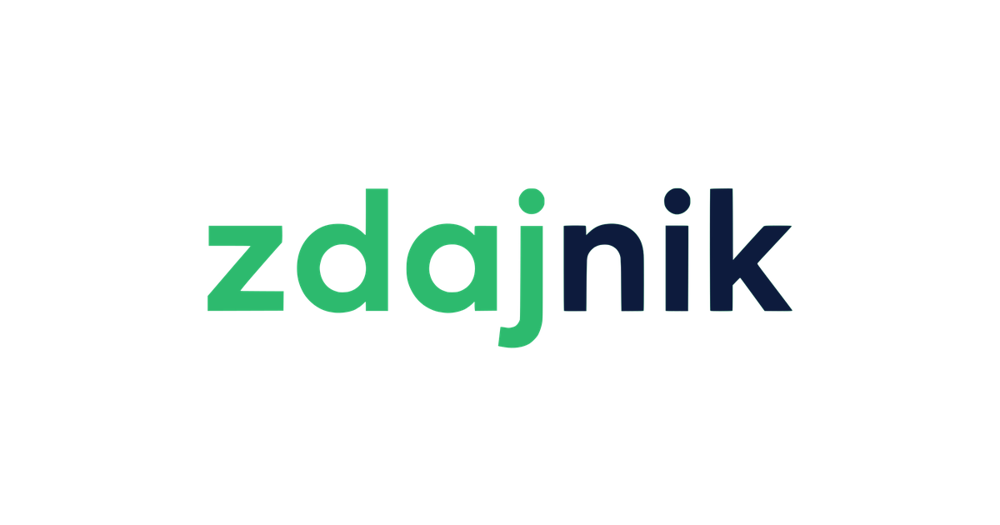

<p align="center">
  
</p>

<h1 align="center">Zdajnik</h1>

<p align="center">
  Platforma e-learningowa pomagająca uczniom techników w Polsce przygotować się<br>
  do egzaminu zawodowego z kwalifikacji <strong>INF.02</strong>, <strong>INF.03</strong> i <strong>INF.04</strong>.
</p>

<p align="center">
  <a href="https://www.zdajnik.pl"><strong>zdajnik.pl »</strong></a>
</p>

<p align="center">
  
  
  
  
</p>

---

## Geneza

Zdajnik nie powstał w agencji marketingowej. Powstał z frustracji ucznia technikum, który sam
uczył się do egzaminu zawodowego i nie mógł znaleźć bazy pytań, która nie byłaby albo płatna,
albo źle poukładana, albo po prostu błędna. Projekt rozwijam samodzielnie od czerwca 2025 — od
prostego logowania i jednej mechaniki quizu, przez pełny egzamin próbny na czas, panel
statystyk, wyszukiwarkę pytań, aż po panel administracyjny z własną analityką i zautomatyzowany
proces wdrożenia na produkcję.

## Funkcje

- **Symulacja egzaminu** — pełny test próbny (40 pytań, 60 minut, jak na prawdziwym egzaminie),
  tryb "Jedno Pytanie" do szybkiej powtórki oraz spersonalizowany test z wyborem działów.
- **Wyjaśnienia do pytań** — po odpowiedzi widać nie tylko "źle", ale i dlaczego dana opcja jest
  poprawna (treść pytań, odpowiedzi i wyjaśnień renderowana z Markdowna, z obsługą bloków kodu).
- **Filtry nauki** — nieodkryte, słabe punkty, powtórki, ostatnie błędy, zapisane pytania.
- **Statystyki postępów** — opanowanie materiału po działach, trend skuteczności, lista
  krytycznych błędów do powtórki przed egzaminem.
- **Wyszukiwarka pytań** — po treści, numerze ID, kwalifikacji i temacie.
- **Konta użytkowników** — rejestracja z weryfikacją e-mail, logowanie przez Google OAuth,
  reset hasła, dwuetapowe usuwanie/anonimizacja konta.
- **Panel administracyjny** — zarządzanie użytkownikami, egzaminami i pytaniami, własny moduł
  analityki (ruch, źródła, zdarzenia), logi audytowe.
- **Wdrożenie** — własny skrypt deployu przez SSH (backup, `git pull --ff-only`,
  `composer install`, build assetów, opcjonalne migracje) spięty z GitHub Actions.

## Stos technologiczny

| Warstwa | Technologia |
|---|---|
| Backend | PHP 8.2, czyste PDO (bez ORM), Composer (PSR-4) |
| Baza danych | MySQL 8.0, migracje w stylu dbmate |
| Frontend | Vanilla JS (moduły ES), SCSS (architektura ITCSS), bez frameworka JS |
| Auth | Sesje PHP, Google OAuth, weryfikacja e-mail, ochrona CSRF |
| Infrastruktura | Docker / docker-compose (PHP 8.2 + Apache, MySQL 8.0) |
| CI/CD | GitHub Actions + własny skrypt `deploy.php` (SSH, backup, migracje) |

Świadomie zbudowane bez frameworka — własny router (86 tras), własny kontener kontrolerów,
własna warstwa dostępu do bazy. Backend w architekturze zbliżonej do MVC: `Router` →
`Controller` → `Service`/`Model` → `View` (plain PHP templates, bez silnika szablonów).

## Architektura w skrócie

```
public/index.php          punkt wejścia — autoload, .env, sesja, Router
app/Core/Router.php        jedno źródło prawdy dla wszystkich tras
app/Controllers/           logika żądań, dziedziczą po BaseController
app/Services/               logika biznesowa (auth, walidacja, mailing, analityka, admin)
app/Models/                 dostęp do danych per encja
views/                      widoki PHP (bez Blade/Twig), views/admin/ dla panelu CMS
public/                     assety statyczne, wejście frontowe aplikacji
db/migrations/               migracje SQL (dbmate)
```

## Uruchomienie lokalnie

```bash
git clone https://github.com/t-szerszen/zdajnik.git
cd zdajnik
cp .env.example .env        # uzupełnij dane bazy / mailera / OAuth
composer install
npm install && npm run build:css
docker-compose up
```

Aplikacja wystartuje pod `http://localhost:8080` (PHP 8.2 + Apache), baza MySQL pod `:3306`.

## Status i plany rozwoju

Gotowe i dostępne: kwalifikacje **INF.03** i **INF.04** (pełna baza pytań, wszystkie tryby
nauki). W przygotowaniu: baza pytań **INF.02**, biblioteka arkuszy praktycznych oraz kursy
wideo dla technika informatyka.

## Autor

Tobiasz Szerszeń — uczeń technikum, tworzy Zdajnika samodzielnie od podstaw.
